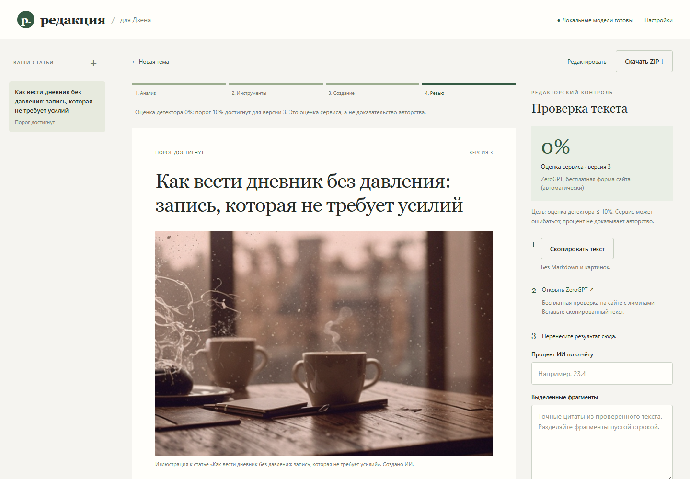
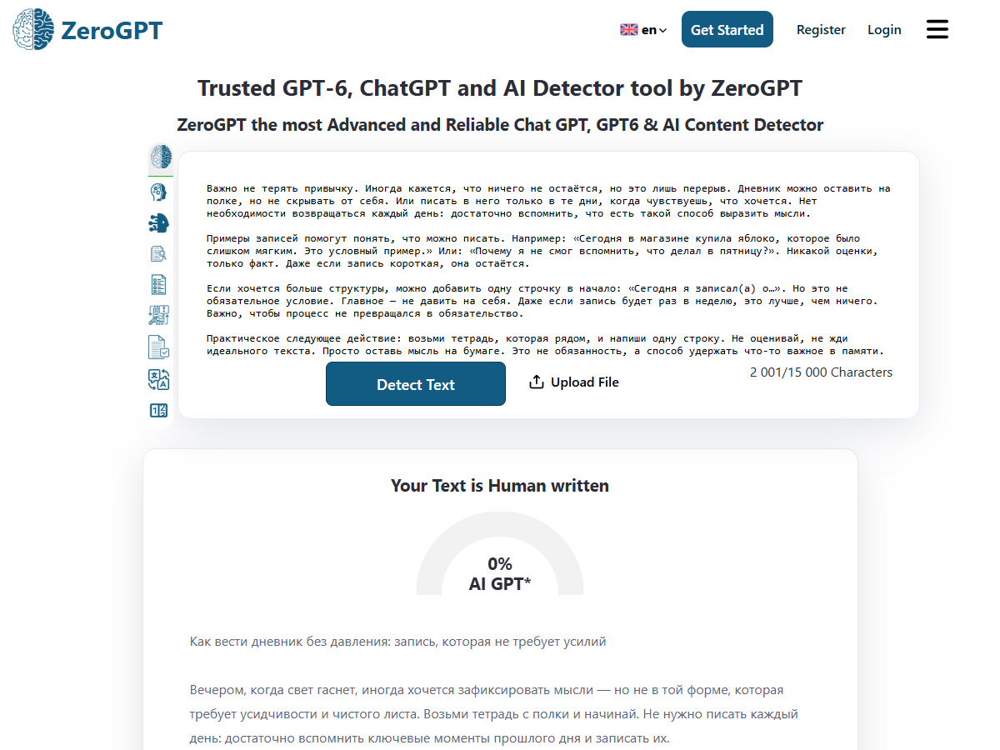
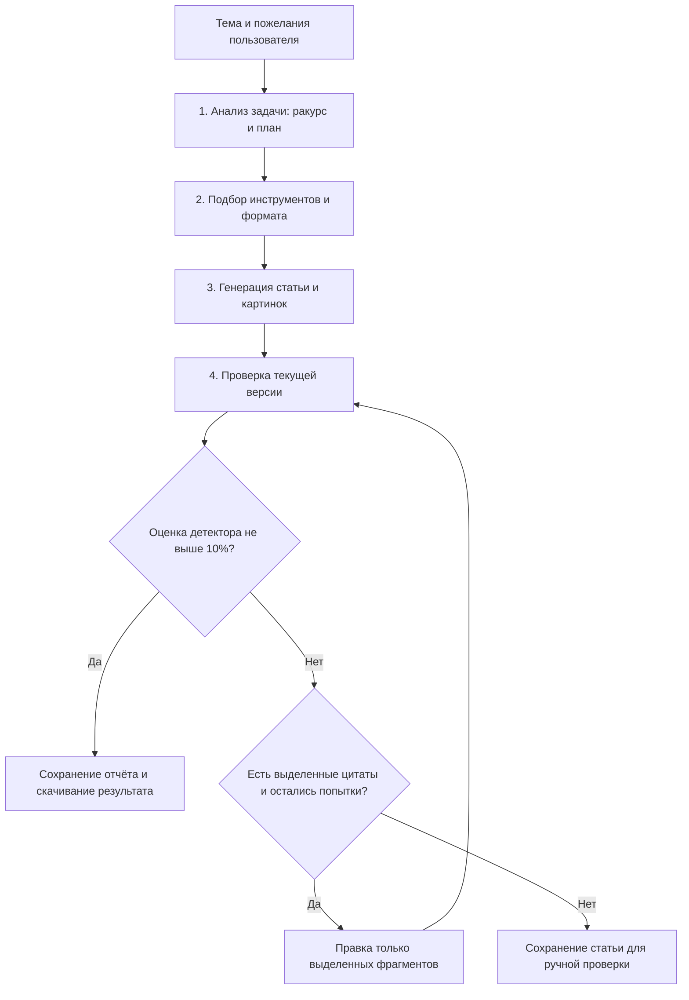

# Chain — «Редакция»: генератор статей для Дзена

Учебный проект по теме **«Цепочки запросов (Chains)»**. Приложение получает тему статьи, составляет план, подбирает настроенные инструменты, создаёт текст и 1–2 иллюстрации, затем проверяет результат и при необходимости дорабатывает отдельные фрагменты.

**Проект реализован на Python. Для работы с ним не нужно писать код: управление происходит в браузере, установка и запуск выполняются двумя файлами `.cmd`.**

Ссылка для сдачи задания: **https://github.com/pasha-tsaran/Chain**.

## Быстро посмотреть результат

Проверяющему не обязательно сразу скачивать модели. В репозитории есть готовые материалы:

- [Пример статьи с двумя картинками](examples/demo/article.md).
- [Отчёт учебного испытания](examples/demo/report.json).
- [План, составленный на первом этапе](examples/demo/plan.json).
- [Журнал точечных замен](examples/demo/revisions.json).
- [Подробное описание проверки проекта](ПРОВЕРКА.md).

В реальном испытании ZeroGPT сначала показал **32,6%**, выделив **10 предложений**. После точечной доработки повторная проверка показала **0%**. Посимвольная проверка подтвердила, что текст за пределами выделенных фрагментов не изменился. Это результат одного испытания, а не обещание такого процента для любой статьи.





## Где в проекте реализован Chain

**Chain означает последовательность связанных этапов: результат предыдущего этапа становится входными данными следующего.** Это принцип организации программы. **LangChain** — отдельная библиотека для построения таких программ. В этом проекте она не используется: цепочка написана обычными функциями Python, что соответствует варианту задания «или в любом другом инструменте».

Главное место в коде — **функция `generate()` в [workflow.py](workflow.py)**. В ней последовательно выполняются четыре этапа. Они отмечены комментариями «ЭТАП 1» — «ЭТАП 4» и отображаются в интерфейсе приложения.

| Этап из задания | Что делает программа | Что получает следующий этап | Где смотреть код |
|---|---|---|---|
| **1. Анализ задачи** | Разбирает тему, аудиторию, пожелания и исходные материалы. Модель определяет ракурс, пользу для читателя, план и идеи иллюстраций. | Структурированный план `article['plan']`. | `generate()`: вызов `llm.call(prompts.ANALYZE, article['brief'])`; шаблон `ANALYZE` в [prompts.py](prompts.py). |
| **2. Подбор инструментов** | По настройкам выбирает модель текста, способ создания картинок, режим проверки и формат подачи. Выбор делает код из предусмотренных вариантов. | Список инструментов `article['tools']` и инструкция по оформлению `article['format_instruction']`. | `generate()`: блок выбора `FORMATS` и заполнения `article['tools']`; настройки в [storage.py](storage.py). |
| **3. Реализация — генерация результата** | Передаёт автору исходное задание вместе с планом и форматом. Получает статью, выполняет внутреннюю литературную редактуру и создаёт иллюстрации. | Текст из блоков `article['blocks']`, заголовок, картинки и сохранённая версия. | `generate()`, `validate_draft()`, `editorial_review()`, `generate_images()`; шаблоны `WRITE`, `REVIEW`, `IMAGE_BRIEF`. |
| **4. Проверка / ревью** | Проверяет текущую версию через ZeroGPT или принимает настоящий отчёт с сайта. При оценке выше 10% исправляет только выделенные цитаты и проверяет новую версию заново. | Отчёт, история правок и итоговый статус: порог достигнут, нужна доработка или ручная проверка. | `detection_loop()`, `attach_report()`, `patch_detected()` в [workflow.py](workflow.py); шаблон `REWRITE`. |

Автор получает **не одну тему**, а результат предыдущих этапов: `brief + plan + format`. А редактор получает **готовый текст и конкретные замечания**. В этом и заключается связь звеньев Chain.

### Схема цепочки



Если бесплатный сайт недоступен, приложение сохраняет результат и предлагает перенести отчёт вручную. Ошибка сервиса не засчитывается как 0%.

### Та же логика простыми словами

```text
получить тему и пожелания
1. составить план статьи
2. выбрать настроенные инструменты и формат
3. написать статью по плану, отредактировать её и создать картинки
4. проверить текущую версию
   если процент выше 10% и есть выделенные фрагменты:
       заменить только эти фрагменты
       сохранить новую версию
       проверить её заново
   если лимит доработок исчерпан или нет отчёта:
       сохранить статью и показать, что нужна ручная проверка
сохранить результат и дать скачать ZIP
```

По умолчанию допускаются **три доработки** по детектору. Это ограничивает цикл: программа не переписывает статью бесконечно. Каждая проверка связана с конкретной версией текста; после изменения статьи старый процент не считается действующим.

## Что умеет приложение

- Принимать тему, аудиторию, объём, пожелания и исходные материалы.
- Создавать статью с подзаголовками, жирным текстом, курсивом, списками или таблицей — по смыслу и выбранной подаче.
- Менять подачу между соседними статьями в автоматическом режиме выбора формата.
- Создавать одну или две тематические картинки локально.
- Выполнять литературное ревью и проверку через внешний детектор.
- Исправлять только точные цитаты, выделенные детектором, сохраняя остальной текст.
- Хранить статьи, версии, замечания редактора и отчёты на компьютере.
- Давать редактировать текст вручную и скачивать результат в ZIP.

## Как скачать и запустить без программирования

### Если проект уже установлен на вашем компьютере

Откройте файл **`Запустить Редакцию.cmd`** в папке проекта. Должна открыться страница [http://127.0.0.1:8765](http://127.0.0.1:8765). Этот адрес работает на компьютере, где запущена программа.

### Если вы скачиваете проект с GitHub впервые

1. На странице репозитория нажмите зелёную кнопку **Code → Download ZIP**.
2. Распакуйте скачанный архив в отдельную папку. Не запускайте файлы прямо из ZIP.
3. Установите **Python 3.12, 64-bit** с [официального сайта Python](https://www.python.org/downloads/windows/). Команда `python` должна быть доступна после установки. В классическом установщике для этого отмечают **Add python.exe to PATH**. Для подготовленного установщика проекта используйте именно ветку Python 3.12.
4. Установите [Ollama для Windows](https://ollama.com/download/windows) и запустите её.
5. Дважды нажмите **`Установить модели.cmd`** и дождитесь завершения. При первой установке понадобятся интернет, время и место для нескольких гигабайт моделей и библиотек. Программирование не требуется: установщик выполняет команды сам.
6. Дважды нажмите **`Запустить Редакцию.cmd`**.

Проверенная конфигурация: **Windows, Python 3.12, NVIDIA RTX 3070 Laptop с 8 ГБ видеопамяти**. Для бесплатной автоматической проверки также нужен **Microsoft Edge**. Работа на другом оборудовании может отличаться по скорости и потреблению памяти.

GitHub хранит исходный код проекта. Само приложение запускается на компьютере после скачивания, а не внутри страницы GitHub.

## Как создать статью

1. Нажмите **«Новая тема»** или **«+»**.
2. Напишите тему, например: «Как начать вести бумажный дневник, если не хочется писать каждый день».
3. Укажите аудиторию, объём, подачу и число иллюстраций.
4. При необходимости раскройте **«Пожелания и исходные материалы»**. Вставьте проверенные факты и выдержки из источников. Сами ссылки приложение автоматически не открывает.
5. В **«Настройках»** выберите способ проверки на ИИ. В чистой установке выбран ручной режим; для автоматизации выберите **«Автоматически через бесплатный сайт ZeroGPT (Edge)»**.
6. Нажмите **«Создать статью»** и следите за четырьмя этапами.
7. Прочитайте результат и замечания редактора. При необходимости исправьте текст; после изменения нужна новая проверка.
8. Нажмите **«Скачать ZIP»**. В архиве будут HTML, Markdown, текст для детектора, картинки и отчёт. В редактор Дзена перенесите статью и загрузите картинки отдельно.

Приложение не публикует статью в Дзен автоматически. Для генерации не нужен вход в аккаунт Дзена.

## Как устроена проверка на ИИ

Предусмотрены три режима:

| Режим | Как пользоваться | Что требуется |
|---|---|---|
| **Ручной перенос отчёта** | Скопировать текст кнопкой, проверить его на ZeroGPT, вернуть процент и точные выделенные цитаты в приложение. | Интернет и доступ к бесплатной форме сайта. |
| **Автоматическая бесплатная форма** | Приложение открывает отдельный фоновый Edge, заполняет публичную форму и читает видимый результат. | Интернет, Edge, доступная форма ZeroGPT. |
| **ZeroGPT Business API** | Приложение отправляет запросы через официальный API. | Платный доступ и собственные JWT/API Key. |

Бесплатный режим использует [форму ZeroGPT](https://www.zerogpt.com/). Его работа зависит от доступности сайта и его лимитов. При CAPTCHA или изменении формы приложение предлагает ручной перенос; обход ограничений не выполняется. [Официальный Business API](https://api.zerogpt.com/docs) подключается отдельно и не является бесплатным.

**В автоматических режимах текст статьи передаётся внешнему сервису ZeroGPT.** В ручном режиме вы делаете это самостоятельно через сайт. Ключи для платного API хранятся только локально и не входят в репозиторий.

**Процент детектора — оценка сервиса, а не доказательство авторства или качества.** Даже 0% не означает, что текст написан человеком, не содержит ошибок или готов к публикации. Перед публикацией нужно прочитать статью и проверить факты.

## Можно ли сделать это на локальных моделях

**Генерация текста, литературное ревью и картинки работают локально.** Для текста используется Ollama с Qwen3 8B, для изображений — SD-Turbo. После скачивания моделей эти операции могут работать без интернета.

Модели используют видеокарту последовательно: текстовая модель освобождает видеопамять перед созданием картинок. По завершении процесс изображений закрывается и освобождает память.

**Проверка в ZeroGPT требует интернета.** Отдельный локальный классификатор мог бы давать собственную оценку, но она не была бы процентом ZeroGPT; такой классификатор в этой версии не включён.

Небольшие локальные модели могут допускать опечатки, повторы и неудачные советы. Редакторский проход помогает выявить часть ошибок, но не гарантирует литературное качество и достоверность любой статьи. Гарантировать результат детектора не выше 10% для произвольной темы также нельзя.

## Файлы проекта

| Файл или папка | Назначение |
|---|---|
| [workflow.py](workflow.py) | Главная цепочка, четыре этапа, версии и цикл доработки. |
| [prompts.py](prompts.py) | Отдельные инструкции анализатору, автору, редактору и генератору описаний картинок. |
| [providers.py](providers.py) | Обращение к Ollama и официальному ZeroGPT Business API. |
| [browser_detector.py](browser_detector.py) | Бесплатная проверка через публичную форму ZeroGPT в Edge. |
| [image_worker.py](image_worker.py) | Создание изображений в отдельном процессе. |
| [server.py](server.py) | Локальный веб-сервер и скачивание результата. |
| [storage.py](storage.py) | Сохранение статей и настроек. |
| [static/](static/) | Страницы, оформление и кнопки приложения. |
| [tests/](tests/) | Автоматические проверки логики и локального сервера. |
| [examples/demo/](examples/demo/) | Подготовленный учебный пример, картинки и отчёты. |
| [docs/screenshots/](docs/screenshots/) | Скриншоты для проверки задания без установки моделей. |
| [ПРОМПТ_И_АНАЛИЗ.md](ПРОМПТ_И_АНАЛИЗ.md) | Задание для разработки, анализ промпта и связь с уроком. |
| [docs/USER_GUIDE.md](docs/USER_GUIDE.md) | Подробная инструкция и устранение неполадок. |

Папки `.venv`, `models`, `data`, журналы и настройки создаются локально и исключены через `.gitignore`. Учебный пример в `examples/demo` опубликован отдельно, чтобы проверяющий мог увидеть результат.

## Как проверить проект

Для просмотра достаточно скриншотов и файлов из `examples/demo`. Если установлен Python, автоматические тесты можно запустить без скачивания моделей и без платных ключей:

```powershell
python -m unittest discover -s tests -v
```

При подготовке проекта прошли **29 тестов**. Они проверяют точечные замены, неизменность соседнего текста, версии отчётов, порог 10%, ограничение доработок, переход к ручной проверке, экспорт и защиту локального сервера. Платный API проверялся на контролируемых ответах; реальный бесплатный браузерный режим проверялся на учебной статье.

Если приложение не запускается, начните с [раздела устранения неполадок](docs/USER_GUIDE.md#если-что-то-не-работает). Если модели не установлены, повторно запустите `Установить модели.cmd`.

## Соответствие заданию и текст для сдачи

| Требование | Как выполнено |
|---|---|
| Собственная цепочка из 3–4 звеньев | Четыре основных этапа в `workflow.py`. |
| Анализ задачи | Модель составляет структурированный план по теме и пожеланиям. |
| Подбор инструментов | Программа выбирает предусмотренные инструменты по настройкам. |
| Генерация результата | Создаются статья и 1–2 иллюстрации. |
| Проверка / ревью | Литературная редактура, внешний отчёт и ограниченный цикл точечных правок. |
| Реализация и описание | Работающий Python-код, схема, пояснения и инструкция в репозитории. |
| Формат сдачи | Ссылка на GitHub-репозиторий; дополнительно приложены скриншоты и учебный результат. |

Текст, который можно вставить в ответ на задание:

> Выполнен учебный проект «Редакция» — генератор статей для Дзена. Реализована цепочка из четырёх этапов: анализ задачи, подбор инструментов, генерация статьи с иллюстрациями и проверка результата с точечной доработкой. Цепочка написана на Python; основной код находится в `workflow.py`, функция `generate()`. В README приведены логика этапов, схема и инструкция запуска. В репозитории приложены скриншоты, пример статьи и отчёты проверки. Ссылка: https://github.com/pasha-tsaran/Chain.

Исходный урок: [«VPf05. Цепочки запросов (Chains)»](https://university.zerocoder.ru/pl/teach/control/lesson/view?id=345148518).
