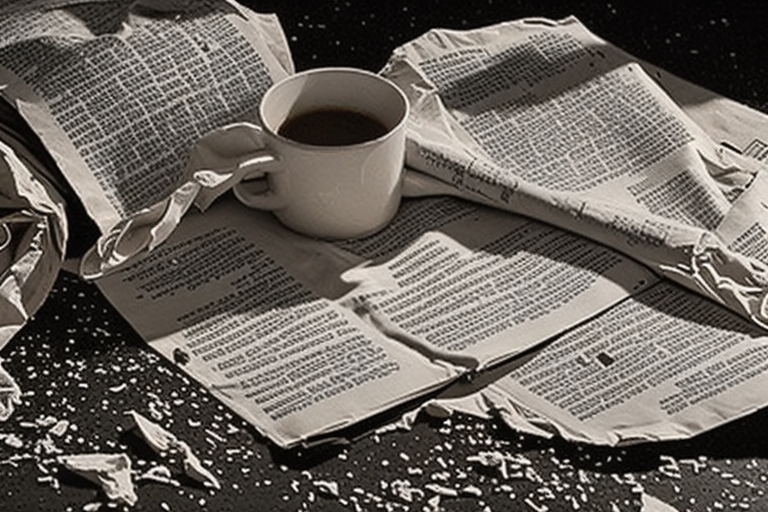

# Как вести дневник без давления: запись, которая не требует усилий

Вечером, когда свет гаснет, иногда хочется зафиксировать мысли — но не в той форме, которая требует усидчивости и чистого листа. Возьми тетрадь с полки и начинай. Не нужно писать каждый день: достаточно вспомнить ключевые моменты прошлого дня и записать их.

**Выбор формата** — это первый шаг. Тетрадь, блокнот или даже лист бумаги, который остался от чека в магазине в магазине. Бумага должна быть чистой, а ручка — не высыхать. Некоторые выбирают тонкие тетради, другие — тяжёлые, с плотной бумагой. Нет строгих условий: подойдёт любая доступная бумага.

Записывать можно в разной степени. Одно предложение о том, что вчера было неожиданно приятно. Или вопрос: «Что я упустил в сегодняшнем разговоре?» Не стоит украшать строки, не стоит судить, насколько это «хорошо» или «плохо». Даже если текст нечитаем, это всё равно запись. Она не обязывает к чему-то.

Важно не терять привычку. Иногда кажется, что ничего не остаётся, но это лишь перерыв. Дневник можно оставить на полке, но не скрывать от себя. Или писать в него только в те дни, когда чувствуешь, что хочется. Нет необходимости возвращаться каждый день: достаточно вспомнить, что есть такой способ выразить мысли.

**Примеры записей** помогут понять, что можно писать. Например: *«Сегодня в магазине купила яблоко, которое было слишком мягким. Это условный пример.»* Или: *«Почему я не смог вспомнить, что делал в пятницу?»*. Никакой оценки, только факт. Даже если запись короткая, она остаётся.

Если хочется больше структуры, можно добавить одну строчку в начало: *«Сегодня я записал(а) о…»*. Но это не обязательное условие. Главное — не давить на себя. Даже если запись будет раз в неделю, это лучше, чем ничего. Важно, чтобы процесс не превращался в обязательство.

Практическое следующее действие: возьми тетрадь, которая рядом, и напиши одну строку. Не оценивай, не жди идеального текста. Просто оставь мысль на бумаге. Это не обязанность, а способ удержать что-то важное в памяти.